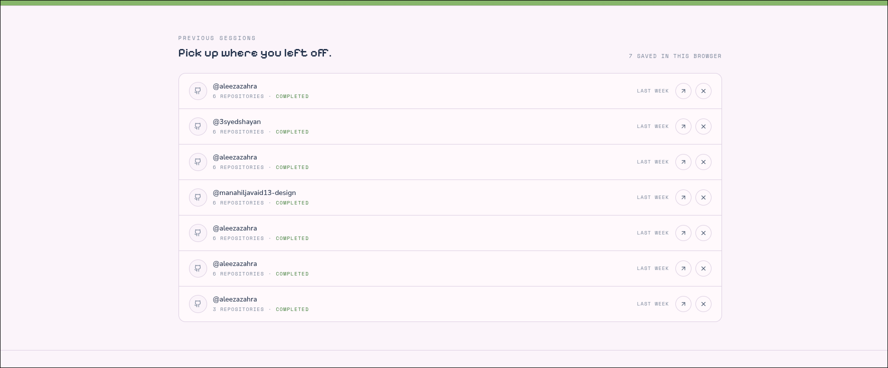
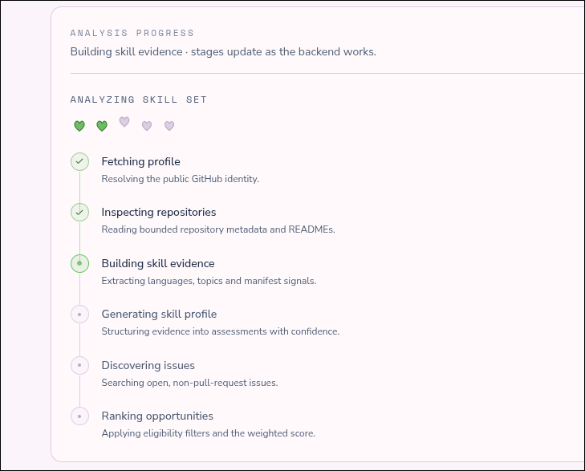
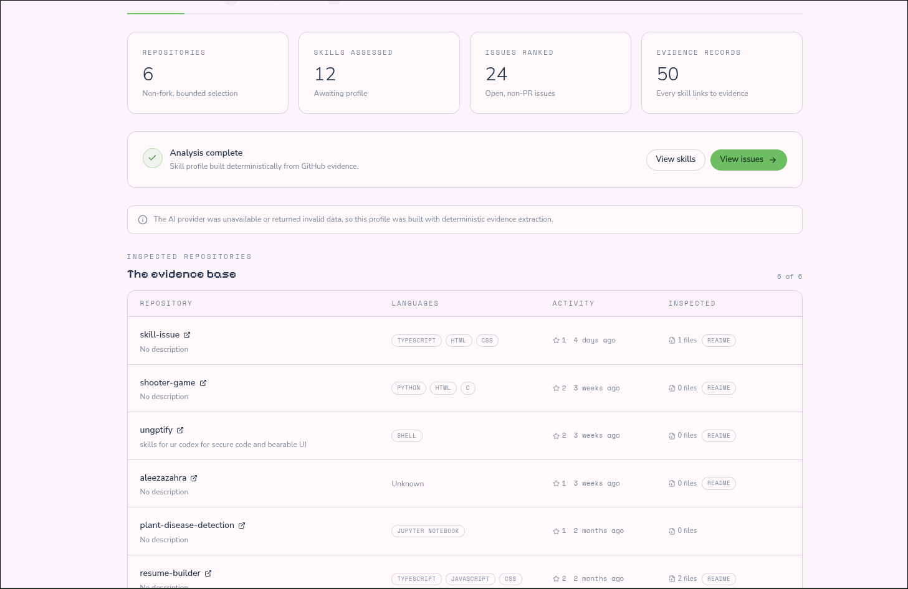
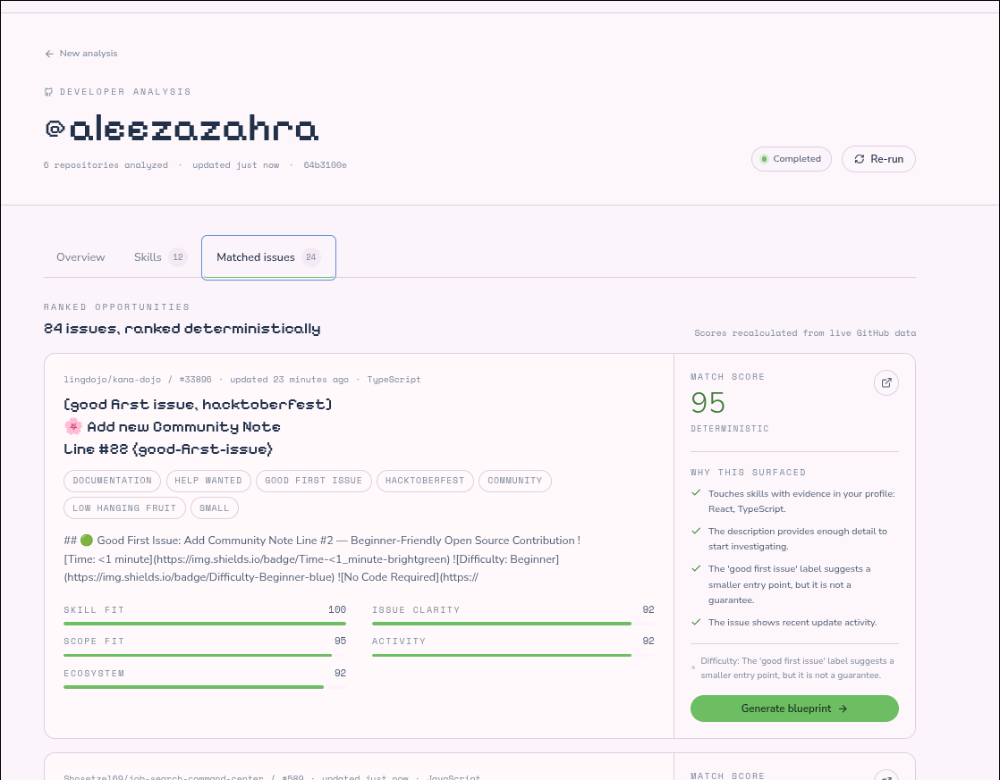

# SkillIssue
Stop searching for issues. Start shipping contributions.

Skillissue analyzes a public GitHub profile, builds an evidence-backed skill
profile, discovers real open issues, ranks them with a deterministic, explainable score, and
generates a grounded contribution blueprint for a selected issue.

## Features
- simple to use and a cool cute ui 
- no login or github integration js asks for a username to analyze stuff
- uses gemma 4 to generate blueprint of the issues /PRS and stuff
- gives a match score too so one can see which fits them perfectly 

## Stack

- React + Vite + TypeScript + Tailwind CSS + TanStack Query + React Router
- Node.js + Express + TypeScript + Zod
- Gemma 4 via Ollama (local) with an OpenRouter fallback adapter
- GitHub REST API
- In-memory persistence (MongoDB-ready seam in `apps/api/src/db/store.ts`)
- Opencode 
## ScreenShots :






## Repository layout

```text
apps/
  api/       Express API, GitHub client, AI providers, matching, jobs
  web/       React + Vite frontend
packages/
  shared/    Shared types and Zod schemas
docs/        Architecture and demo script
```

## Running this locally

```bash
npm install

# AI (local)
ollama pull gemma2:9b
# smaller / faster dev option: ollama pull gemma2:2b

cp .env.example .env
# edit .env as needed

npm run dev:api   # http://localhost:4000
npm run dev:web   # http://localhost:5173
```

The Vite dev server proxies `/api` to the API on port 4000.

## Environment

See `.env.example`. Key variables:

| Variable | Purpose |
| --- | --- |
| `AI_PROVIDER` | `ollama` or `openrouter` |
| `OLLAMA_BASE_URL` | Default `http://localhost:11434` |
| `OLLAMA_MODEL` | Default `gemma2:9b` |
| `OPENROUTER_API_KEY` | Enables hosted fallback |
| `OPENROUTER_MODEL` | Hosted model id |
| `GITHUB_TOKEN` | Optional; raises GitHub rate limits |
| `MONGODB_URI` | Reserved for persistence |

API keys stay server-side. Nothing provider-related is exposed to the browser.


## Scoring

```text
Match = 0.35 × Skill Fit
      + 0.25 × Issue Clarity
      + 0.20 × Scope Fit
      + 0.10 × Activity Signal
      + 0.10 × Ecosystem Fit
```


## Build

```bash
npm run build        # shared + api + web
npm run start:api    # serve compiled API
```


